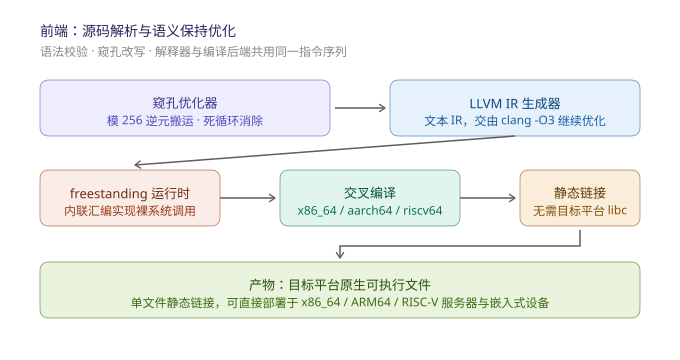

# BrainFuck Compiler

基于 LLVM 的 BrainFuck 语言编译器与解释器，C++17 实现，单一源文件构建。

## 概述

本项目提供一个完整的 BrainFuck 工具链：源码经语义保持的窥孔优化后，可直接解释执行，或生成为 LLVM IR 并由 clang + lld 编译为本机及交叉目标平台的原生可执行文件。

针对 Linux 交叉编译目标，编译器自动生成 freestanding 运行时（以目标架构内联汇编实现 `read`/`write`/`exit` 裸系统调用），产物为单文件静态链接可执行文件，不依赖目标平台的 libc。



## 特性

- **优化与执行**：手写窥孔优化器（算术合并取模、搬运循环改写、死循环消除、`knownZero` 数据流分析），且全程保持与标准语义一致；解释器直接执行优化后的指令序列。
- **LLVM 后端**：生成文本 IR 交由 `clang -O3` 完成深层优化，由 lld 链接。
- **交叉编译**：支持 Linux x86_64、aarch64、riscv64 三个目标，静态链接，可部署于无 libc 环境（服务器精简容器、嵌入式设备等）。
- **语义可配置**：数据带大小可调（默认 1 MiB，支持 K/M/G 后缀），静态分配，带越界保护。
- **跨平台 CLI**：Windows 下正确处理控制台代码页与二进制模式 I/O。

## 编译流程

```
BrainFuck 源码 → 解析 / 语义保持优化 → LLVM IR (.ll) → clang -O3 + lld → 可执行文件
```

- `SourceParser` 负责语法校验与语义保持优化，产出共享的指令序列；
- 解释器直接执行该序列；`IrEmitter` 将其展开为 LLVM IR；
- 交叉编译仅为 LLVM 后端的目标配置，不存在另一套指令执行实现。

## 构建与依赖

依赖：C++17 编译器、LLVM 开发库（含 clang 与 lld 工具链）。

```sh
clang++ -std=c++17 -O2 BrainFuck.cpp -o brainfuck
```

系统需可找到 `clang`、`ld.lld`（或 `lld-link`）以完成编译与链接阶段。

## 用法

```
brainfuck interpret <file.bf>           解释执行优化后的指令
brainfuck run <file.bf>                 编译为本机可执行文件并运行
brainfuck compile <file.bf>             编译为本机可执行文件
brainfuck compile <file.bf> --target T  交叉编译为 T 平台的静态可执行文件
brainfuck ir <file.bf> [out.ll]         仅生成 LLVM IR
brainfuck targets                       列出支持的交叉编译目标
```

选项：

| 选项 | 说明 |
|------|------|
| `--target T` | 交叉编译目标（Linux x86_64 / aarch64 / riscv64） |
| `--tape-size N` | 数据带单元格数量，默认 1 MiB，支持 K/M/G 后缀 |

## 语言约定

- 8 位单元格，算术回绕（mod 256）
- 输入结束（EOF）时读入单元格置 0
- 数据带静态分配，大小由 `--tape-size` 指定，越界访问受保护
- 非 BF 指令字符（除命令行语法外）一律视为注释

## 示例

```sh
# 解释执行
brainfuck interpret examples/hello.bf

# 编译为当前平台可执行文件
brainfuck compile examples/hello.bf -o hello

# 交叉编译为 RISC-V Linux 静态可执行文件
brainfuck compile examples/hello.bf --target riscv64 -o hello-riscv64

# 查看 LLVM IR
brainfuck ir examples/hello.bf hello.ll
```

## 许可证

MIT License
